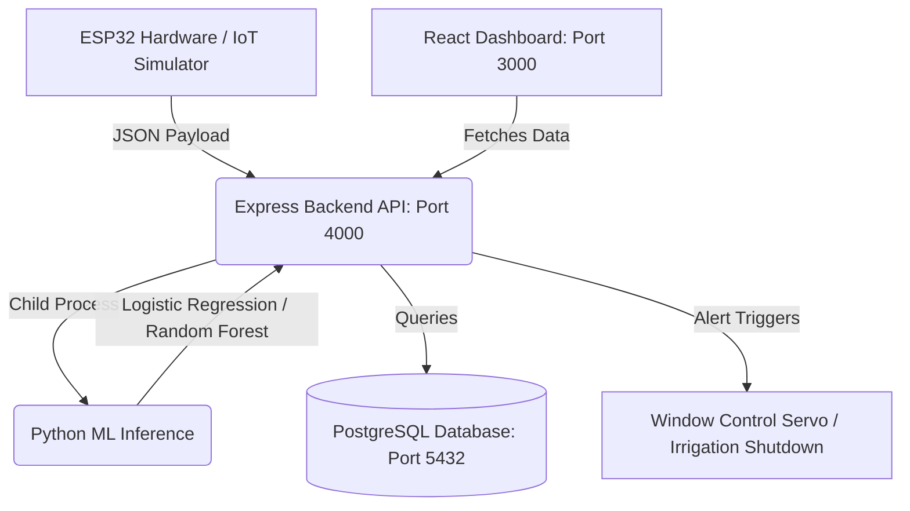

# 🚀 Startup Guide: Smart Rain AI & IoT System

Welcome to the **Smart Rain Detection and Prediction System using AI & IoT**. This guide provides step-by-step instructions to set up, configure, and run this system from scratch after cloning it from GitHub onto a new machine.

---

## 🏛️ System Architecture

This project is a multi-tier IoT application integrating hardware, backend APIs, relational databases, machine learning, and interactive dashboards:



---

## 📋 System Prerequisites

Before beginning, ensure the following software is installed on the target machine:

| Prerequisite | Recommended Version | Purpose |
| :--- | :--- | :--- |
| **Node.js** | `v18.x` or newer (LTS) | Runs the Express backend, React frontend, and IoT simulator |
| **Docker Desktop** | Latest | Recommended for running the PostgreSQL database and all services in containers |
| **Python** | `v3.9` to `v3.11` | Required for training machine learning models and running inference |
| **PostgreSQL** | `v14` or newer | Relational database (if running manually without Docker) |
| **Arduino IDE** | `v2.x` | Required for uploading code to physical ESP32 boards |

---

## 🛠️ Step-by-Step Setup

You can launch the system using two pathways: **Option A (Docker Containerization - Recommended)** or **Option B (Manual Local Setup)**.

### Option A: Docker Compose Deployment (Recommended)

Docker handles Node.js, Python, PostgreSQL, and all dependencies in a single isolated environment.

1. **Verify Docker Status**:
   Ensure Docker Desktop is running on your machine:
   ```bash
   docker --version
   docker compose version
   ```

2. **Launch Services**:
   From the root folder of the project, run:
   ```bash
   docker compose up --build -d
   ```
   This will spin up three containers:
   *   `db`: PostgreSQL listening on port `5432`
   *   `backend`: API server running on port `4000` (pre-configured with Python & dependencies for ML inference)
   *   `frontend`: React application listening on port `3000`

3. **Access Interfaces**:
   *   **React Dashboard**: [http://localhost:3000](http://localhost:3000)
   *   **Backend Health Check**: [http://localhost:4000/api/v1/health](http://localhost:4000/api/v1/health)

---

### Option B: Manual Local Setup

If you prefer to run services natively or don't use Docker, follow these steps:

#### Step 1: Database Setup
1. Open your PostgreSQL console or client (e.g. pgAdmin).
2. Create a new database named `smart_rain`:
   ```sql
   CREATE DATABASE smart_rain;
   ```
3. Load the schema into the newly created database:
   ```bash
   psql -U postgres -d smart_rain -f database/schema.sql
   ```

#### Step 2: Environment Variables
Create the environment configuration files from the templates provided:

1. **Backend Environment Setup**:
   Copy the example `.env` file in the `backend` folder:
   ```bash
   cp backend/.env.example backend/.env
   ```
   Edit `backend/.env` with your PostgreSQL login credentials:
   ```env
   PORT=4000
   NODE_ENV=development
   JWT_SECRET=your_jwt_secret_key
   DB_HOST=localhost
   DB_PORT=5432
   DB_USER=postgres
   DB_PASSWORD=your_postgres_password
   DB_NAME=smart_rain
   PYTHON_EXECUTABLE=python
   ```

2. **Frontend Environment Setup**:
   Copy the example `.env` file in the `frontend` folder:
   ```bash
   cp frontend/.env.example frontend/.env
   ```
   *(Ensure `REACT_APP_API_BASE_URL` is set to `http://localhost:4000/api/v1`)*

#### Step 3: AI/ML Environment & Model Training
The backend API requires trained machine learning models to classify rain states and predict rainfall intensity.

1. Navigate to the `ai` directory:
   ```bash
   cd ai
   ```
2. Create and activate a Python virtual environment:
   *   **Windows**:
       ```powershell
       python -m venv venv
       .\venv\Scripts\Activate.ps1
       ```
   *   **macOS / Linux**:
       ```bash
       python3 -m venv venv
       source venv/bin/activate
       ```
3. Install Python dependencies:
   ```bash
   pip install -r requirements.txt
   ```
4. Train the ML models:
   ```bash
   python train.py
   ```
   > [!NOTE]
   > This command reads historical data from `ai/data/weather_sample.csv` and saves the trained models (`rain_detector.joblib` and `rain_forecaster.joblib`) into `ai/models/`.

5. Navigate back to the root:
   ```bash
   cd ..
   ```

#### Step 4: Run the Backend API
1. Navigate to the `backend` folder:
   ```bash
   cd backend
   ```
2. Install Node dependencies:
   ```bash
   npm install
   ```
3. Start the API in development mode:
   ```bash
   npm run dev
   ```
   *(The server will start on [http://localhost:4000](http://localhost:4000). You should see `Smart Rain API running on port 4000`)*

4. Open a new terminal window and navigate back to root.

#### Step 5: Run the Frontend App
1. Navigate to the `frontend` folder:
   ```bash
   cd frontend
   ```
2. Install dependencies:
   ```bash
   npm install
   ```
3. Start the React server:
   ```bash
   npm start
   ```
   *(The dashboard will open automatically in your browser at [http://localhost:3000](http://localhost:3000))*

---

## 📡 Simulating IoT Data

To test the system without uploading code to physical microcontrollers, you can use the built-in IoT data simulator.

1. Navigate to the root directory.
2. Run the simulator script:
   ```bash
   node iot-simulator/send_mock_data.js
   ```
   > [!TIP]
   > The simulator automatically reads `mock-data/sensor_payload.json` and posts realistic sensor telemetry (temperature, humidity, atmospheric pressure, and rain levels) to the backend every 8 seconds. Watch your React dashboard update in real-time!

---

## 🔌 Hardware Setup (ESP32)

To connect physical sensors, flash the ESP32 board:

1. **Wiring Mapping**:
   Wire your microcontroller according to [docs/WIRING_DIAGRAM.md](file:///c:/Users/ghanshyam/Documents/Projects/smart-rain-ai-iot-system/docs/WIRING_DIAGRAM.md).
2. **Library Requirements**:
   In Arduino IDE, open **Sketch → Include Library → Manage Libraries** and install:
   *   `DHT sensor library` (Adafruit)
   *   `Adafruit Unified Sensor`
   *   `Adafruit BMP280 Library`
   *   `ESP32Servo`
3. **Flash Code**:
   *   Open `ESP32_SENSOR_CODE.ino` in Arduino IDE.
   *   Configure your WiFi SSID, password, and the backend server IP in the code configuration section.
   *   Select your board (**Tools → Board → ESP32 Dev Module**) and Port.
   *   Click **Upload**.

---

## 🚨 Troubleshooting

> [!WARNING]
> **Error: listen EADDRINUSE: address already in use :::4000**
> Another process is already running on port 4000. Find and terminate it:
> *   **Windows**:
>     ```powershell
>     Stop-Process -Id (Get-NetTCPConnection -LocalPort 4000).OwningProcess -Force
>     ```
> *   **macOS / Linux**:
>     ```bash
>     kill -9 $(lsof -t -i:4000)
>     ```

> [!IMPORTANT]
> **Database connection throws ECONNREFUSED**
> Verify that the PostgreSQL service is actively running and that the credentials matched in `backend/.env` are correct.
